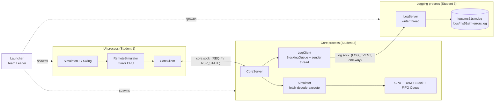

# Week 4 - Three-process architecture 

## 2. IPC architecture diagram


(SVG version: `ipc-architecture.svg`)



Request path of one **Step** click:

```
UI: Step button -> RemoteSimulator.step() -> CoreClient.step()
      --- core.sock: REQ_STEP --->
Core: CoreServer.dispatch -> Simulator.step()  [fetch(); decode(); execute(); update_Status()]
      -> CPU / RAM / stack / queue change -> LogClient.log(...)  (queued, non-blocking)
      --- core.sock: RSP_STATE (CpuState + StepResult) --->
UI: apply CpuState to mirror CPU -> TraceFormatter -> repaint panes
Core (in parallel): log-sender thread --- log.sock: LOG_EVENT --->  Logger: writer thread -> ms51sim.log
```

